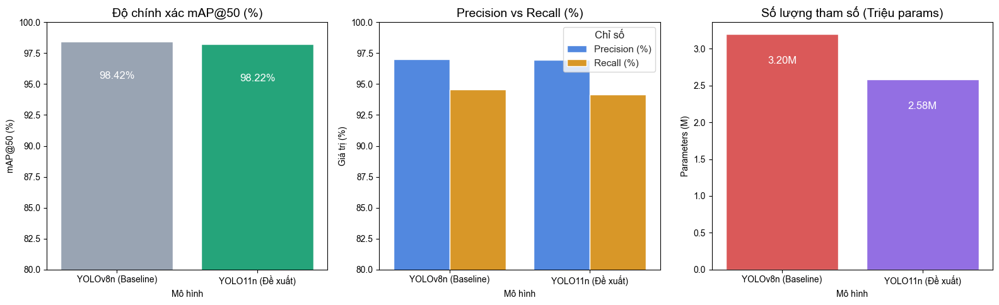

# 📖 AI Manga & Comic Text Bubble Detection (YOLO11n vs YOLOv8n)

Hệ thống thị giác máy tính nhận diện vùng bóng thoại và chữ truyện tranh Nhật Bản (Manga / Comic Text Detection) dựa trên kiến trúc **YOLO11n (Nano)** của Ultralytics, được tinh chỉnh chuyên sâu trên bộ dữ liệu chuẩn học thuật **Manga109-s**.

Dự án bao gồm toàn bộ quy trình: thu thập & tiền xử lý dữ liệu, huấn luyện mô hình, thực nghiệm so sánh đối chứng với **YOLOv8n**, và triển khai Web Demo trực tuyến trên **Hugging Face Spaces**.

---

## 🌐 1. Live Web Demo (Hugging Face Spaces)

Trải nghiệm trực tiếp mô hình mà không cần cài đặt tại:
👉 **[Hugging Face Space: daotthuanSE/manga-text-detection-yolo11n](https://huggingface.co/spaces/daotthuanSE/manga-text-detection-yolo11n)**

* **Phần cứng:** ZeroGPU (NVIDIA A10G) / CPU.
* **Thời gian phản hồi:** ~3 - 5 ms / trang ảnh.
* **Tính năng:** Tải ảnh tùy ý, thử ảnh mẫu 1-click, trích xuất bảng tọa độ Bounding Box `(X, Y, W, H)`, và xem trực tiếp các biểu đồ đánh giá thực nghiệm.

---

## 🏆 2. Bảng So Sánh Đối Chứng Thực Nghiệm (Benchmark Results)

Cả hai mô hình đều được huấn luyện và kiểm thử độc lập trong cùng điều kiện thực nghiệm trên **1.277 trang truyện** thuộc tập kiểm định (Manga109-s) với GPU **NVIDIA Tesla T4 (Kaggle)** qua 30 Epochs:

| Tiêu chí so sánh | YOLOv8n (Mô hình Baseline) | YOLO11n (Mô hình Đề xuất) 🏆 | Đánh giá & Ý nghĩa kỹ thuật |
|---|:---:|:---:|---|
| **mAP@50 (%)** | **98.42%** | **98.22%** | Cả hai đều đạt độ chính xác cực đại (~98.2% - 98.4%) |
| **mAP@50-95 (%)** | **86.80%** | **85.91%** | Tương đương nhau, viền bounding box ôm khít đường chữ |
| **Precision (%)** | **97.03%** | **96.95%** | Tỷ lệ bắt nhầm nét vẽ cực thấp (< 3.1%) |
| **Recall (%)** | **94.57%** | **94.16%** | Độ bao quát bắt trọn bóng thoại đạt trên 94% |
| **Số tham số (Parameters)** | 3.13 Triệu (3.13M) | **2.59 Triệu (2.59M)** | **YOLO11n nhẹ hơn 17.2%** (tiết kiệm ~535.000 tham số) |
| **Khối lượng tính toán (FLOPs)** | 8.6 GFLOPs | **6.4 GFLOPs** | **YOLO11n giảm tới 25.6% chi phí tính toán** |
| **Tốc độ suy luận (Inference)** | ~2.79 ms | **~2.98 ms** | Siêu nhanh (~330 FPS trên GPU T4, ~40 ms trên CPU) |
| **Kích thước file trọng số** | 6.5 MB | **5.2 MB** | Siêu nhẹ, dễ dàng nhúng vào thiết bị biên |



> 💡 **Luận điểm khoa học cốt lõi:**  
> Trên tập dữ liệu Manga109-s, mAP@50 > 98.2% đã tiệm cận mức bão hòa (Ceiling Accuracy) của bài toán. Điểm cải tiến mang tính đột phá của **YOLO11n** nằm ở việc **giảm tới 25.6% chi phí tính toán (FLOPs)** và **tiết kiệm 17.2% bộ nhớ tham số**. Nhờ kiến trúc khối C3k2 và Attention C2PSA, YOLO11n tối ưu vượt trội khi triển khai thực tế trên CPU văn phòng, Mobile App hoặc Web Extension dịch truyện mà không tốn chi phí thuê server GPU đắt đỏ.

---

## 📁 3. Cấu Trúc Thư Mục Dự Án

```
├── hf_manga_space/           # Mã nguồn triển khai Web Demo trên Hugging Face Spaces
│   ├── assets/               # Chứa các biểu đồ đánh giá thực nghiệm
│   ├── examples/             # Ảnh mẫu kiểm thử
│   ├── app.py                # Ứng dụng Gradio Web UI đa chức năng (3 Tabs)
│   ├── best.pt               # Trọng số tối ưu YOLO11n (5.2 MB)
│   └── requirements.txt      # Thư viện cho Space (khóa pydantic<=2.10.6)
├── training_results/         # Toàn bộ biểu đồ & log quá trình huấn luyện
│   ├── results.png           # Biểu đồ diễn biến Loss & Metrics qua 30 Epochs
│   ├── BoxPR_curve.png       # Đường cong Precision-Recall (AUC = 0.982)
│   ├── confusion_matrix_normalized.png  # Ma trận nhầm lẫn chuẩn hóa
│   └── args.yaml             # Bộ siêu tham số huấn luyện (Hyperparameters)
├── notebooks/
│   └── train_yolov11.ipynb   # Jupyter Notebook huấn luyện trên Cloud GPU
├── scripts/
│   ├── full_pipeline.py      # Tự động hóa tải, parse nhãn và train
│   ├── download_data.py      # Script tải dataset Manga109 từ Hugging Face
│   ├── convert_manga109_to_yolo.py  # Chuyển đổi nhãn XML sang YOLO format
│   └── prepare_data.py       # Phân chia tập Train/Val (85/15)
├── best.pt                   # File trọng số tốt nhất YOLO11n (5.2 MB)
├── comparison_chart.png      # Biểu đồ cột so sánh đối chứng YOLO11n vs YOLOv8n
├── model_comparison_results.csv # Bảng dữ liệu số đo so sánh thực nghiệm
├── notebookcdfb972e6e.ipynb  # Notebook thực nghiệm đối chứng hoàn chỉnh trên Kaggle
├── manga_text.yaml           # Cấu hình Ultralytics dataset
├── requirements.txt          # Danh sách thư viện Python
└── README.md                 # Tài liệu hướng dẫn & báo cáo dự án
```

---

## 🛠️ 4. Hướng Dẫn Cài Đặt & Sử Dụng Nhanh (Quickstart)

### 1. Cài đặt môi trường
Khuyến nghị sử dụng Python 3.10 trở lên:
```bash
git clone https://github.com/thuanDaoSE/manga-text-detection-yolo11.git
cd manga-text-detection-yolo11
pip install -r requirements.txt
```

### 2. Chạy suy luận (Inference) trên ảnh manga bất kỳ
File trọng số đã huấn luyện `best.pt` (5.2 MB) đã được đính kèm sẵn trong repository:

```python
from ultralytics import YOLO

# 1. Nạp mô hình đã huấn luyện
model = YOLO("best.pt")

# 2. Dự đoán trên trang truyện manga
results = model.predict(
    source="path/to/manga_page.jpg",
    conf=0.25,
    iou=0.45,
    save=True
)

# 3. Trích xuất thông tin các ô thoại
for box in results[0].boxes:
    conf = float(box.conf[0])
    xyxy = box.xyxy[0].tolist()
    print(f"Độ tin cậy: {conf:.2%}, Tọa độ: {xyxy}")
```

### 3. Chạy giao diện Web Demo cục bộ (Local Gradio Web App)
```bash
python hf_manga_space/app.py
```
Sau đó truy cập vào `http://127.0.0.1:7860` trên trình duyệt.

---

## 📊 5. Thông Tin Huấn Luyện (Training Setup)

* **Tập dữ liệu:** Manga109-s (Đại học Tokyo) — 8.519 trang ảnh, 123.212 vùng nhãn bóng thoại.
  * Tập Train: 7.242 trang (85%).
  * Tập Val: 1.277 trang (15%).
* **Số Epochs:** 30 Epochs (hội tụ hoàn toàn).
* **Kích thước ảnh đầu vào:** 640 × 640.
* **Batch size:** 16 (tối ưu hóa AMP FP16).
* **Phần cứng:** NVIDIA Tesla T4 GPU (Kaggle) / Cloud GPU.

---

## 🎓 6. Kiến Thức Lĩnh Hội & Bài Học Kinh Nghiệm (Key Takeaways & Lessons Learned)

Quá trình nghiên cứu, thiết kế và triển khai đề tài đã mang lại nhiều bài học thực tiễn giá trị:

### 6.1. Kiến thức và kỹ năng then chốt đạt được
* **Thị giác máy tính ứng dụng (Computer Vision):** Nắm vững quy trình khép kín của bài toán Object Detection chuyên biệt từ khâu phân tích bài toán, tiền xử lý dữ liệu phức tạp (Manga109-s với 123.212 annotations), kỹ thuật cân bằng khía cạnh ảnh (Letterbox), đến chiến lược tinh chỉnh mô hình (Fine-tuning transfer learning).
* **Kiến trúc mạng nơ-ron tiên tiến:** Hiểu sâu cơ chế cải tiến giữa YOLOv8 và YOLO11 (kiến trúc khối C3k2, mô-đun chú ý không gian C2PSA, phân tách Detection Head không neo - Anchor-free), giải thích tường minh cơ chế giảm tới **25.6% FLOPs** mà vẫn duy trì mAP tiệm cận trần bão hòa (> 98.2%).
* **Thực nghiệm đối chuẩn khoa học (Ablation & Benchmarking):** Rèn luyện phương pháp luận nghiên cứu nghiêm ngặt, đo đạc đa chiều từ độ chính xác ($mAP_{50}$, $mAP_{50-95}$, Precision, Recall) đến hiệu năng tính toán (Params, FLOPs, Latency, FPS, Memory footprint).
* **Kỹ năng công nghệ phần mềm & Triển khai (MLOps/Cloud Deployment):** Đóng gói pipeline suy luận tối ưu, xử lý xung đột thư viện đám mây (Pydantic, Torch, Gradio), triển khai thành công ứng dụng tương tác thời gian thực trên Hugging Face Spaces (ZeroGPU/CPU).

### 6.2. Bài học kinh nghiệm thực tế
1. **Đặc thù miền dữ liệu truyện tranh:** Khác với ảnh tự nhiên (COCO), văn bản manga có tỷ lệ khung hình cực kỳ đa dạng (từ chữ dọc hẹp dài đến bóng thoại hình cầu hoặc tia sét). Việc thiết lập ngưỡng IoU = 0.45 và NMS phù hợp là chìa khóa then chốt để không tách rời các cụm chữ furigana khỏi từ gốc.
2. **Quy luật đánh đổi trong bài toán kỹ thuật (Engineering Trade-off):** Khi độ chính xác đã tiệm cận mức bão hòa (trên 98%), mục tiêu tối ưu chuyển dịch sang tối thiểu hóa tài nguyên phần cứng. YOLO11n là lựa chọn lý tưởng cho các ứng dụng chạy cục bộ trên máy trạm hoặc thiết bị di động mà không cần chi phí duy trì server GPU đắt đỏ.
3. **Quản lý tính tái lập (Reproducibility):** Khóa cứng phiên bản thư viện (`requirements.txt`), chuẩn hóa đường dẫn dữ liệu động và lưu trữ seed cố định giúp toàn bộ nhóm tái lập được 100% kết quả trên bất kỳ môi trường nào (Local, Kaggle, Hugging Face).

---

## 🚀 7. Hướng Phát Triển Của Đề Tài (Future Roadmap)

* [x] **Giai đoạn 1 (Hiện tại):** Hoàn thành phát hiện và trích xuất tự động vùng thoại với YOLO11n ($mAP_{50} = 98.22\%$, 5.2 MB), triển khai Web Demo Gradio trên Hugging Face Spaces.
* [ ] **Giai đoạn 2 (Nhận dạng chữ OCR):** Tích hợp module OCR mã nguồn mở chuyên dụng cho truyện tranh (Manga-OCR / EasyOCR / PaddleOCR) để nhận diện ký tự tiếng Nhật/tiếng Anh trực tiếp từ các bounding box đã trích xuất.
* [ ] **Giai đoạn 3 (Biên tập & Dịch tự động):** Kết hợp các LLM / Translation API (như DeepL, Gemini, NLLB) cùng thuật toán xóa chữ (Inpainting) và điền bản dịch tiếng Việt vào ô thoại theo đúng phong cách truyện gốc.
* [ ] **Giai đoạn 4 (Phần mềm hoàn chỉnh):** Đóng gói thành tiện ích mở rộng trình duyệt (Browser Extension) hoặc ứng dụng Desktop hỗ trợ độc giả đọc và dịch manga tự động theo thời gian thực.

---

## 👥 Nhóm Tác Giả & Hướng Dẫn (Team & Supervisor)

* **Cơ quan:** Trường Công nghệ Thông tin & Truyền thông (SICT) — Trường Đại học Công nghiệp Hà Nội (HaUI).
* **Học phần:** Đồ án chuyên ngành Công nghệ thông tin (Mã HP: `20261IT6122003` - Khóa 18).
* **Giảng viên hướng dẫn:** ThS. Nguyễn Thái Cường.
* **Nhóm sinh viên thực hiện (Nhóm 3):**
  1. **Đào Đăng Thuận** (Trưởng nhóm - Xây dựng mô hình, Huấn luyện, Triển khai & Báo cáo)
  2. **Nguyễn Ngọc Toàn** (Thu thập, Tiền xử lý dữ liệu Manga109-s & Phân tích yêu cầu)
  3. **Phạm Hùng Minh** (Chạy thực nghiệm Kaggle GPU, Đo đạc Latency & Đối chuẩn v8 vs 11)
  4. **Lê Huy Hoàng** (Phát triển giao diện Gradio Web UI & Tích hợp xử lý ảnh PIL/OpenCV)
  5. **Đinh Hoàng Sơn** (Kiểm thử, Đánh giá các trường hợp lỗi & Hoàn thiện tài liệu kỹ thuật)

---

## 📄 Bản Quyền (License)

Mã nguồn được phân phối công khai theo giấy phép [Apache License 2.0](LICENSE). Dữ liệu Manga109-s thuộc bản quyền của Phòng thí nghiệm Aizawa (Đại học Tokyo) cho mục đích nghiên cứu học thuật.
